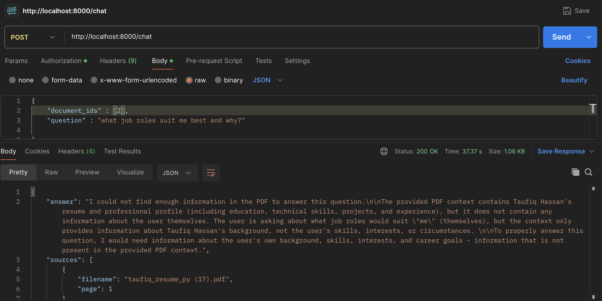
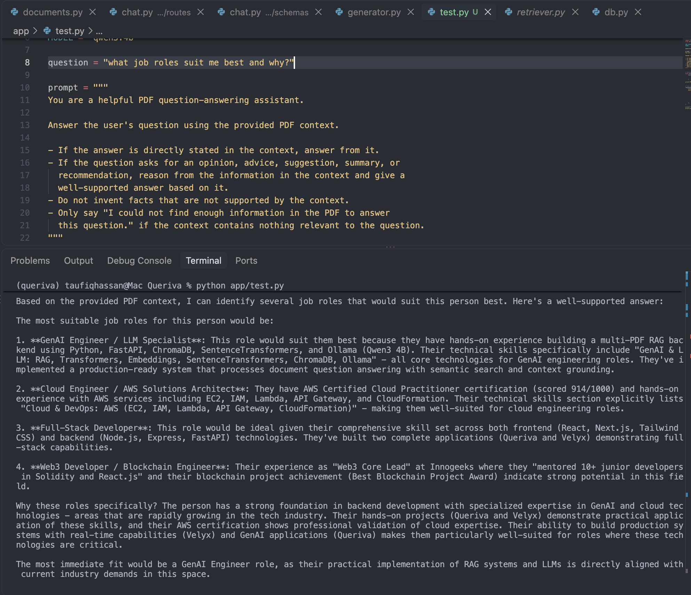

# RAG Retrieval Failure: for indirect questions

## Objective

Investigate how context provision and retrieval strategies affect a multi-PDF RAG system, particularly when answering indirect questions.

## Testing: Full PDF Context vs. Retrieval

**Approaches tested**
- **Full context:** Pass the PDF content directly to the LLM.
- **Retrieval-based:** Retrieve relevant chunks and use them as context for generation.

**Question:** "What job roles suit me best and why?"

**Observation:** The full-context approach generated job-role recommendations based on the resume. However, the earlier retrieval-based approach returned an insufficient-information response because it failed to provide enough relevant context.

**Takeaway:** A RAG system can fail to answer a question even when the source document contains potentially useful information, if retrieval does not surface the relevant evidence.

## Solution: Query Expansion

**Problem:** The original retrieval pipeline struggled with an indirect question that required connecting information across skills, projects, and experience.

**Improvement:** Added query expansion to generate alternative search queries before retrieval.

**Observation:** The improved pipeline generated job-role recommendations grounded in the resume's technical skills, projects, and experience.

**Takeaway:** Query expansion can help retrieve relevant evidence for questions that are not directly phrased like the source text.

## Current Retrieval Pipeline

1. Accept the question and selected document IDs.
2. Generate alternative queries through query expansion.
3. Retrieve candidate chunks using semantic search and document-level filtering.
4. Aggregate and rank the retrieved candidates.
5. Generate an answer using the selected context and source references.