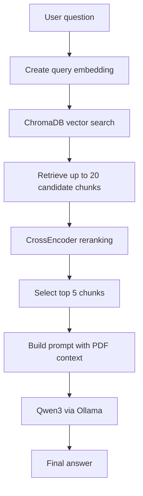
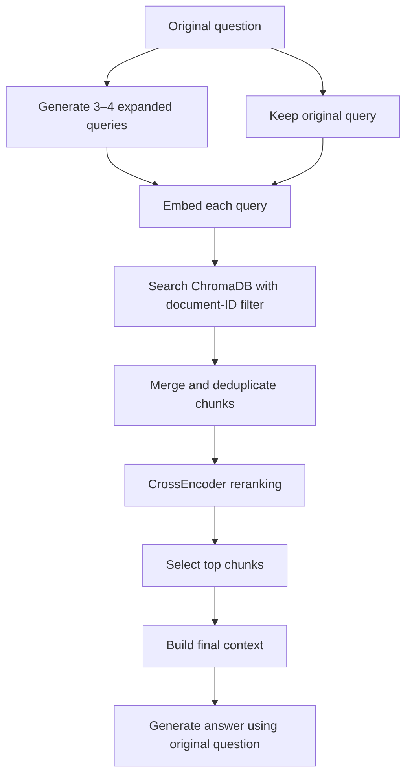

# Improving Retrieval in Queriva

> **Status:** Investigation in progress\
> **Project:** Queriva --- multi-PDF Retrieval-Augmented Generation
> (RAG)\
> **Focus:** Diagnosing failures on indirect questions and evaluating
> retrieval improvements

## 1. Overview

Queriva lets users ask questions about uploaded PDFs. Its pipeline
extracts document text, splits it into chunks, embeds those chunks,
retrieves relevant candidates from ChromaDB, reranks them with a
CrossEncoder, and passes the selected context to a local LLM.

During testing, I observed a discrepancy: a question about suitable job
roles received a useful answer when Qwen3 was given the full extracted
resume text, but the `/chat` RAG endpoint returned an
insufficient-information response.

This led me to investigate whether the difference comes from retrieval,
reranking, context construction, prompt interpretation, or another part
of the pipeline.

**Important:** The screenshots show the observed behaviour, but do not
by themselves prove that retrieval is the root cause. The retrieved
chunks and the exact prompt sent to the generator must be inspected to
isolate the cause.

## 2. Observed issue

Test question:

> What job roles suit me best and why?

### Direct full-document test

I extracted the PDF text and passed it directly to Qwen3. The model
produced a detailed response based on skills, projects, and technologies
described in the resume.

### RAG endpoint test

I sent the same question to the `/chat` endpoint, specifying the
relevant `document_ids`. The endpoint returned an
insufficient-information response.

### Evidence

Add your sanitized comparison screenshot here. See [How to add
images](#8-how-to-add-images-in-markdown).


*Figure 1. Direct inference and RAG endpoint results for the same
question. Replace this placeholder image with your own sanitized
screenshot.*

## 3. Existing retrieval pipeline

The current retrieval flow is:



Current components include:

-   **Embeddings:** SentenceTransformers, using the configured embedding
    model.
-   **Vector store:** ChromaDB with document-ID filtering.
-   **Candidate retrieval:** Up to 20 chunks for the original question.
-   **Reranking:** `cross-encoder/ms-marco-MiniLM-L-6-v2`.
-   **Generation:** Qwen3 4B through Ollama.

## 4. Why indirect questions can be difficult

A question does not always use the same words as the relevant PDF
sections.

For example, "What job roles suit me?" may require evidence from several
parts of a resume:

-   Technical skills and programming languages
-   Projects and technologies used
-   Experience and responsibilities
-   Achievements and relevant domains

A single semantic search might not retrieve all of these types of
evidence. Even if relevant chunks are retrieved, reranking or prompt
construction could still leave important evidence out of the final
context.

This is a hypothesis to investigate, not an assumed root cause.

## 5. Investigation plan

Before changing the retrieval algorithm, inspect each stage
independently.

### 5.1 Inspect initial candidates

Log the original question, candidate chunk text, metadata, and
similarity/distance information returned by the vector store when
available.

Questions to answer:

-   Do relevant chunks appear in the initial top 20?
-   Are the correct document IDs included in the search filter?
-   Are important headings separated from the chunk text?
-   Is the extracted PDF text complete and readable?

### 5.2 Inspect reranking

Record the candidate chunks and CrossEncoder scores before selecting the
final top five.

-   If relevant chunks never appear in the initial candidate set,
    investigate retrieval.
-   If relevant chunks appear initially but disappear after reranking,
    investigate the reranking query and scores.
-   If relevant chunks reach the final context but the answer is still
    poor, inspect the generator prompt, context formatting, and
    generation settings.

### 5.3 Compare the prompts

Compare the direct test and API endpoint for:

-   Exact user question
-   Exact context passed to the model
-   System and user instructions
-   Model name and generation options
-   Context length and truncation
-   Any API-level post-processing or fallback logic

## 6. Proposed approach: query expansion

Query expansion generates alternative searches that express different
evidence needed to answer the original question.

For example, the question "What job roles suit me?" could be expanded
into searches for:

1.  Technical skills and programming languages in the resume
2.  Projects and technologies used
3.  Work experience and technical responsibilities
4.  Relevant technical domains and achievements

These are illustrative examples; generated queries will vary.

### Proposed flow



### Implementation outline

1.  Generate a small number of focused queries with the LLM.
2.  Keep the original question in the query set.
3.  Embed each query using the same embedding model as the indexed
    documents.
4.  Search ChromaDB for each query, preserving the requested document-ID
    filter.
5.  Merge and deduplicate candidate chunks using stable chunk IDs where
    possible.
6.  Rerank the combined candidates.
7.  Pass the selected chunks to the generator while retaining the
    original user question.

### Reranking consideration

A baseline is to rerank each candidate against the original question. An
alternative experiment is to score candidates against multiple queries
and combine those scores, for example using the maximum score. This can
surface evidence that matches one aspect of the question, but it is a
heuristic and should be compared empirically.

### Trade-offs

Potential benefits:

-   May improve recall when different sections use different
    terminology.
-   Can retrieve complementary evidence for questions requiring multiple
    kinds of information.

Potential costs and risks:

-   More embedding and vector-search calls.
-   Additional LLM latency for query generation.
-   More duplicate or irrelevant candidates.
-   Reranking may become slower as the candidate pool grows.
-   Expanded queries may drift from the user's original intent.

## 7. Other techniques to evaluate

### Hybrid search

Combine dense vector search with keyword retrieval such as BM25. This
can help with exact technology names, acronyms, certifications, and
terms that semantic search may under-rank.

### Contextual chunking

Preserve section headings and document structure in chunk text or
metadata. A chunk containing skills should retain enough information to
identify that it belongs to a "Technical Skills" section.

### Parent-child retrieval

Retrieve small chunks for precision but pass a larger parent section or
surrounding context to the generator. This can restore context lost at
chunk boundaries.

### Metadata-aware retrieval

Use metadata such as document ID, page number, section, and chunk ID to
scope searches and preserve traceability. Apply document filtering
consistently to every expanded query.

### Better retrieval evaluation

Create a small set of representative questions and label which chunks
contain useful evidence. Compare methods on the same documents and
questions rather than judging only from the final generated answer.

## 8. How to add images in Markdown

A simple GitHub-friendly structure is:

``` text
Queriva/
├── README.md
└── docs/
    ├── retrieval-improvements.md
    └── assets/
        └── retrieval-before-after.png
```

Save the sanitized comparison image as `retrieval-before-after.png`
inside `docs/assets/`.

Because the Markdown file is inside `docs/`, use a **relative path**:

``` markdown

```

The image will render when GitHub displays the Markdown file, provided
the file exists at that relative path and is committed to the
repository.

Useful tips:

-   Prefer PNG for screenshots.
-   Crop to the relevant code/output and redact names, filenames,
    tokens, local paths, and other private information.
-   Add a short caption explaining what the reader should notice.
-   Keep the image reasonably sized; two tightly cropped screenshots in
    one comparison image are often easier to read than full-screen
    captures.
-   If an image is in the repository root instead, use the correct
    relative path from the Markdown file, such as
    `../assets/example.png`.
-   You can also drag an image into a GitHub issue or pull-request
    comment to upload it, but for project documentation, storing the
    image in the repository makes the relative path predictable.

## 9. Evaluation plan

Compare the baseline and query-expansion versions using the same
questions and documents.

  -----------------------------------------------------------------------
  Measurement                         What it tells us
  ----------------------------------- -----------------------------------
  Recall@k                            Whether known relevant chunks
                                      appear among the top-k candidates

  MRR or nDCG                         How highly relevant chunks rank

  Context coverage                    Whether the final context contains
                                      the evidence needed to answer

  Answer faithfulness                 Whether the response is supported
                                      by the retrieved evidence

  Latency                             The extra time introduced by
                                      expansion and retrieval

  Candidate count                     How much deduplication and
                                      reranking work is required
  -----------------------------------------------------------------------

For a small initial experiment, record at least:

-   Question
-   Relevant chunk IDs, identified before testing where possible
-   Baseline candidate and final chunk IDs
-   Expanded queries and combined candidate IDs
-   Final selected chunk IDs
-   Latency
-   Whether the answer is supported by the document

Do not claim query expansion improves quality until these results show
an improvement on the test set. Keep the test questions and document set
consistent between runs.

## 10. Current status and next steps

**Current status:** The discrepancy between direct full-document
inference and the RAG endpoint has been observed. The precise cause is
still under investigation.

Next steps:

1.  Print the exact chunks passed to the generator.
2.  Check whether relevant chunks appear in the initial top 20.
3.  Compare the API prompt and context with the direct test.
4.  Implement query expansion as a separate experimental branch or
    configuration.
5.  Evaluate baseline and expanded retrieval on the same question set.
6.  Document measured outcomes, including cases where the new approach
    does not help.

## 11. Open questions for the community

-   How do you debug a case where full-document inference works but RAG
    fails?
-   When would you choose hybrid search over query expansion?
-   Have parent-child retrieval or contextual chunking helped with
    indirect questions?
-   Which metrics and small-scale evaluation practices have worked well
    for your RAG applications?

Suggestions and alternative approaches are welcome.
